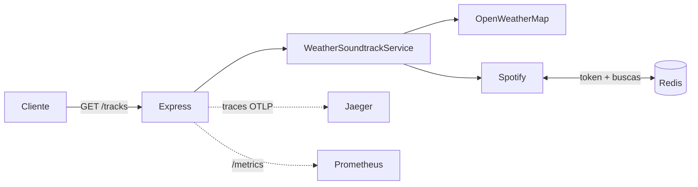

# Weather Playlists

[](https://github.com/uricbonatti/weather-playlists/actions/workflows/ci.yml)


Microsserviço REST que sugere uma **playlist do Spotify de acordo com a temperatura atual** de uma cidade ou coordenada. Foi feito como solução de um [desafio técnico](docs/DESAFIO.md).

| Temperatura | Gênero |
|---|---|
| > 30 °C | festa |
| 15–30 °C | pop |
| 10–14 °C | rock |
| < 10 °C | clássica |

## Destaques técnicos

- **Arquitetura em camadas** (controller → service → providers) com injeção de dependência (`tsyringe`)
- **Cache no Redis** para o token e as buscas do Spotify (TTL de 1 h)
- **Rate limit por IP** e **validação de entrada** com Joi (`celebrate`)
- **Observabilidade:** traces com OpenTelemetry (OTLP → Jaeger), métricas Prometheus em `/metrics` e logs com `traceId`/`spanId`
- **Testes:** 40 unitários (100% de statements) e **e2e com Testcontainers**, que sobem um Redis real; só as APIs externas são simuladas com nock



## Requisitos

- Node.js **22** ou **24**
- Docker (para o Redis local e para os testes e2e)
- Chaves próprias da [OpenWeatherMap](https://openweathermap.org/api) e do [Spotify](https://developer.spotify.com/dashboard)

## Executando

```bash
cp .env.example .env   # preencha as chaves das APIs
npm ci
docker run -d --name weather-redis -p 6379:6379 redis:7-alpine
npm run start:dev
```

```bash
curl "http://localhost:3333/tracks?city=Campinas"
curl "http://localhost:3333/tracks?lat=-23.55&lon=-46.63"
```

### Com Docker Compose (API + Redis + Jaeger)

```bash
cp .env.example .env   # preencha as chaves
docker compose up --build
```

A API sobe em `http://localhost:3333`. Com `ENABLE_TELEMETRY=true` no `.env`, os traces aparecem no Jaeger em `http://localhost:16686`.

## Testes

```bash
npm test               # unitários (com --coverage gera o relatório em coverage/)
npm run test:e2e       # e2e: sobe um Redis real com Testcontainers (requer Docker)
npm run lint
npm run typecheck
```

Os testes e2e não precisam de nenhuma infraestrutura local além do Docker: cada execução cria e descarta os próprios containers.

## API

Documentação OpenAPI em [`docs/openapi.yaml`](docs/openapi.yaml). Abra no [Swagger Editor](https://editor.swagger.io).

| Status | Quando |
|---|---|
| 200 | Playlist encontrada |
| 400 | Sem cidade e sem coordenadas válidas |
| 404 | Cidade não encontrada |
| 429 | Limite de requisições por IP excedido |
| 500 | Erro inesperado |

## Variáveis de ambiente

Veja [`.env.example`](.env.example). As principais:

| Variável | Padrão | Uso |
|---|---|---|
| `OPEN_WEATHER_API_KEY` | — | Chave da OpenWeatherMap |
| `SPOTIFY_CLIENT_ID` / `SPOTIFY_SECRET` | — | Credenciais do Spotify |
| `REDIS_HOST` / `REDIS_PORT` | `localhost` / `6379` | Redis |
| `MAX_REQUESTS` / `MINUTES_RESEND_REQUEST` | `60` / `5` | Rate limit por IP |
| `ENABLE_METRICS` | `false` | Expõe `/metrics` |
| `ENABLE_TELEMETRY` | `false` | Envia traces via OTLP |
| `OTEL_EXPORTER_OTLP_ENDPOINT` | `http://localhost:4318` | Coletor OTLP (ex.: Jaeger) |

## Licença

MIT
